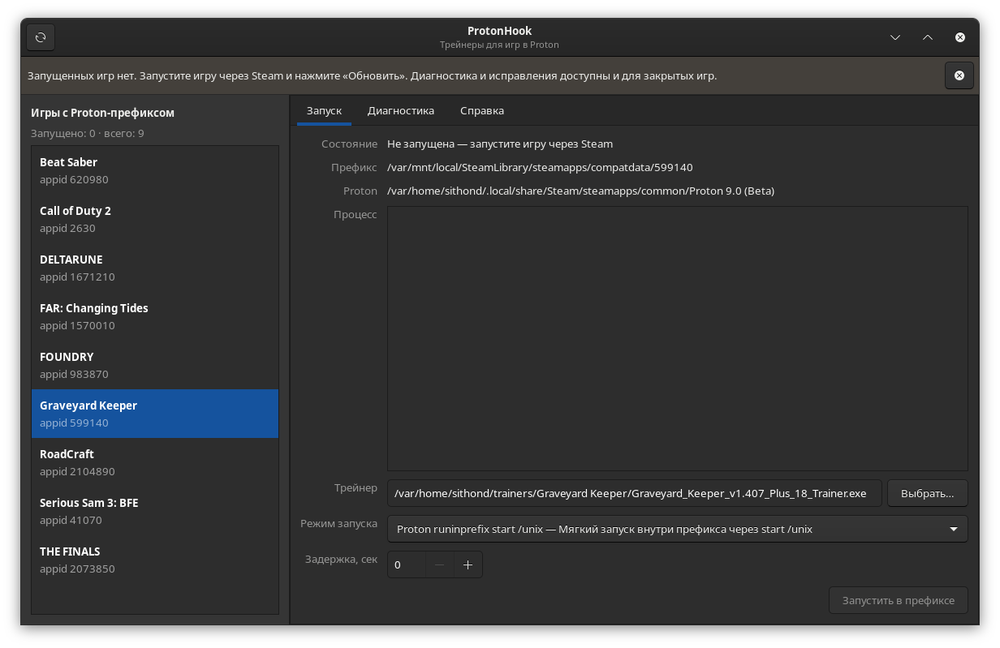
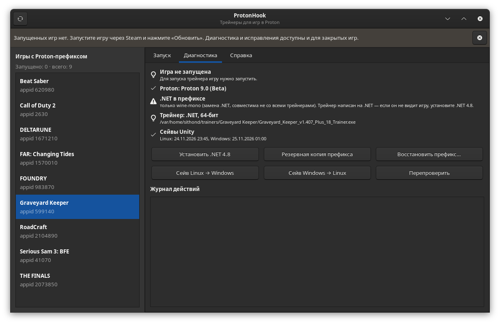
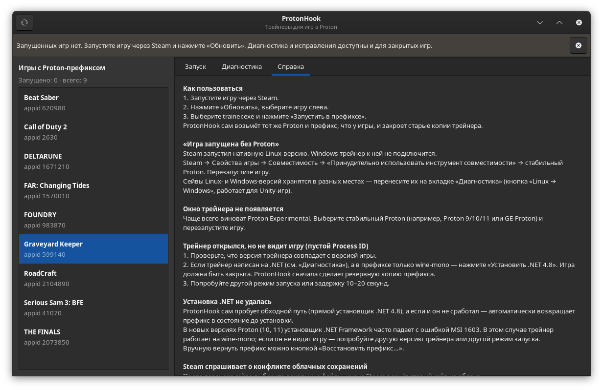

<div align="center">

# ProtonHook

**Запуск Windows-трейнеров для Steam-игр в Linux через Proton — в один клик.**

ProtonHook находит запущенную игру, берёт её Proton и префикс и запускает `trainer.exe` рядом с ней, а если что-то не работает — сам диагностирует и исправляет типичные проблемы.

[](https://github.com/SitHond/ProtonHook/releases/latest)
[](https://github.com/SitHond/ProtonHook/actions/workflows/ci.yml)


[](LICENSE)



</div>

---

## Возможности

- 🎮 **Находит игры** — запущенные через Proton и все игры с Proton-префиксом в ваших библиотеках Steam (включая библиотеки на других дисках).
- 🎯 **Запускает трейнер в правильном окружении** — тот же Proton, тот же префикс, тот же wineserver, что у игры. Три режима запуска и задержка старта.
- 🩺 **Диагностика** — замечает нативную Linux-версию вместо Proton, Proton Experimental, отсутствие .NET для трейнеров, которым он нужен, и устаревшие сейвы.
- 🛠 **Исправляет сам** — ставит .NET Framework 4.8 через protontricks с обходом известных сбоев и автоматическим откатом при неудаче, переносит сейвы Unity-игр между Linux- и Windows-версией, делает и восстанавливает резервные копии префикса.
- 🧹 **Без ручной рутины** — закрывает старые копии трейнера перед запуском, запоминает трейнер для каждой игры и последнюю выбранную игру, сам ищет трейнер в `~/trainers` и `~/Downloads`.
- 📖 **Встроенная справка** — что делать, если окно трейнера не появляется, трейнер не видит игру и т. д.
- 🕹 **Плагин для Decky Loader** — запуск трейнера прямо из Quick Access Menu на Steam Deck.

## Скриншоты

| Диагностика и исправления | Справка |
| :---: | :---: |
|  |  |

## Установка

### Готовый бинарник (рекомендуется)

Один исполняемый файл, GTK уже внутри — ничего ставить не нужно:

```bash
curl -L -o ~/.local/bin/protonhook \
  https://github.com/SitHond/ProtonHook/releases/latest/download/protonhook
chmod +x ~/.local/bin/protonhook
protonhook
```

### Лёгкая версия (`.pyz`, ~100 КБ)

Если в системе уже есть Python 3.10+ и PyGObject (Fedora, Bazzite, большинство дистрибутивов с GNOME/KDE):

```bash
curl -L -o ~/.local/bin/protonhook \
  https://github.com/SitHond/ProtonHook/releases/latest/download/protonhook.pyz
chmod +x ~/.local/bin/protonhook
```

Контрольные суммы файлов — в `SHA256SUMS` на странице релиза.

### Из исходников

```bash
git clone https://github.com/SitHond/ProtonHook.git
cd ProtonHook
python3 steam_trainer_launcher.py
```

Интерфейс — GTK 3 (PyGObject). Если его нет, используется `tkinter`, а если нет и его — пошаговые диалоги `zenity`.

## Как пользоваться

1. Запустите игру через Steam.
2. Откройте ProtonHook — запущенная игра будет вверху списка с пометкой **●**.
3. Выберите `trainer.exe` (в следующий раз ProtonHook подставит его сам) и нажмите **«Запустить в префиксе»**.

Если трейнер не работает — загляните на вкладку **«Диагностика»**: там видно, что не так, и есть кнопки для исправления.

## Частые проблемы

| Симптом | Причина | Что делать |
| --- | --- | --- |
| «Игра запущена без Proton» | Steam запустил нативную Linux-версию | Steam → Свойства → Совместимость → стабильный Proton. Сейвы перенесите кнопкой «Сейв Linux → Windows» |
| Окно трейнера не появляется | Proton Experimental | Выберите стабильный Proton (9 / 10 / 11 или GE-Proton) |
| Трейнер открылся, но не видит игру | Версия трейнера ≠ версии игры, или трейнеру нужен настоящий .NET | Проверьте версию; на «Диагностике» нажмите «Установить .NET 4.8» (игра должна быть закрыта) |
| Установка .NET не удалась | Известный сбой установщика .NET в новых Proton (MSI 1603) | ProtonHook сам откатит префикс; попробуйте другую версию трейнера |
| Steam спрашивает о конфликте сохранений | Сейв перенесён, а в облаке старый | Выберите локальные файлы |

> ⚠️ Используйте трейнеры только в одиночных играх. В играх с античитом (EAC, BattlEye и др.) это может привести к бану.

## Как это работает

1. Читает `libraryfolders.vdf` и `appmanifest_*.acf` всех библиотек Steam.
2. Сканирует `/proc`, определяет `appid` игры по переменным окружения Steam/Proton, командной строке или пути к исполняемому файлу.
3. Определяет Proton игры: из `STEAM_COMPAT_TOOL_PATH(S)` (пропуская контейнеры Steam Linux Runtime), из командной строки родительских процессов или из `compatdata/<appid>/config_info`.
4. Запускает трейнер командой `proton runinprefix start /unix …` (или `runinprefix` / `run`) с окружением игры — трейнер подключается к тому же wineserver, что и игра.

## Файлы и логи

| Что | Где |
| --- | --- |
| Общий лог | `/tmp/protontrek.log` |
| Лог запуска трейнера | `/tmp/protontrek-<игра>-<appid>.log` |
| Резервные копии префиксов и сейвов | `~/ProtonHook-backups/` |
| Настройки (трейнеры, последняя игра) | `~/.config/protonhook/settings.json` |

## Плагин для Decky Loader

Та же логика доступна как плагин для [Decky Loader](https://decky.xyz): выбор игры и запуск `trainer.exe` прямо из Quick Access Menu на Steam Deck, не сворачивая игру.

**Установка:** скачайте `ProtonHook-decky.zip` со [страницы релиза](https://github.com/SitHond/ProtonHook/releases/latest), включите Developer Mode в настройках Decky Loader и выберите **Install Plugin from ZIP**.

<details>
<summary>Сборка и ручная установка</summary>

Нужны Node.js 16.14+ и pnpm v9:

```bash
pnpm install
pnpm run build   # соберёт dist/index.js
```

Скопируйте `plugin.json`, `package.json`, `main.py`, `protontrek_core.py` и папку `dist/` в `~/homebrew/plugins/ProtonHook` на Steam Deck и перезапустите Decky Loader.

- В `plugin.json` намеренно нет флага `root`: бэкенд работает от пользователя `deck`, как Steam с игрой, — этого достаточно для чтения `/proc/<pid>/environ`.
- Выбор `trainer.exe` идёт через встроенный файловый пикер Decky (`openFilePicker` из `@decky/api`).

</details>

## Разработка

```
steam_trainer_launcher.py  точка входа (GTK → tkinter → zenity)
gtk_ui.py                  интерфейс GTK 3
protontrek_core.py         поиск игр, Proton, префиксов и запуск трейнера
protonhook_tools.py        диагностика, .NET, резервные копии, сейвы
main.py, src/              плагин Decky Loader (бэкенд и фронтенд)
packaging/                 сборка бинарника (PyInstaller) и .pyz
```

**Локальная сборка бинарника:**

```bash
python3 -m venv --system-site-packages .venv
.venv/bin/pip install pyinstaller
PYINSTALLER=.venv/bin/pyinstaller packaging/build.sh 0.1.0   # → dist-release/
```

**Выпуск релиза:** достаточно запушить тег — GitHub Actions соберёт бинарник, `.pyz`, плагин Decky и опубликует релиз.

```bash
git tag v0.1.0
git push origin v0.1.0
```

## Лицензия

[MIT](LICENSE) © SitHond
