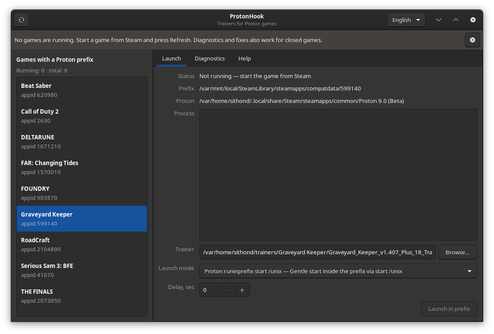
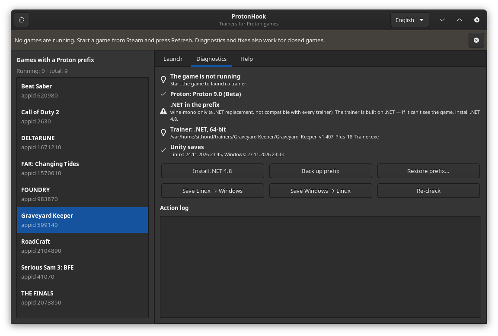
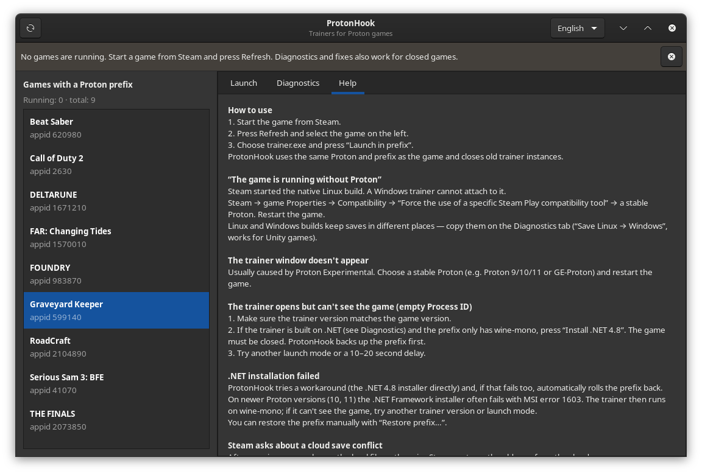

<!-- SITHOND PROJECT README -->

<div align="center">

<sub>SITHOND / PROJECTS</sub>

<br>


# ProtonHook

**Windows trainers for Steam games on Linux. Native experience.**

[](https://github.com/SitHond/ProtonHook/releases)
[](LICENSE)
[](https://github.com/SitHond/ProtonHook/stargazers)


<br>

[](https://sithond.com)
[](https://discord.gg/GdQ68QhWaB)
[](https://github.com/SitHond/ProtonHook/releases/latest)

<br>

[Overview](#overview) ·
[Features](#features) ·
[Installation](#installation) ·
[Usage](#usage) ·
[Troubleshooting](#troubleshooting) ·
[Community](#community)

[English](README.md) · [Русский](README.ru.md)

</div>

---

## Overview

ProtonHook launches Windows trainers (`trainer.exe`) for Steam games that run through Proton on Linux and Steam Deck.

It finds the running game, takes its exact Proton build and prefix, and starts the trainer next to it, attached to the same Wine server. When something goes wrong — the game runs as a native Linux build, the trainer needs .NET, saves are out of sync — ProtonHook detects it and fixes it in one click.

<div align="center">



<sub>ProtonHook — launch tab</sub>

</div>

## Features

- **Game detection** — running Proton games and every game with a Proton prefix across all Steam libraries, including other drives.
- **Correct environment** — the trainer gets the game's Proton, prefix and Wine server; three launch modes and a start delay.
- **Diagnostics** — spots native Linux runs, Proton Experimental, trainers that need .NET (including FLiNG loaders) and outdated saves.
- **One-click fixes** — installs .NET Framework 4.8 via protontricks with automatic rollback on failure, copies Unity saves between the Linux and Windows builds, backs up and restores prefixes.
- **No routine** — closes stale trainer instances, remembers the trainer for each game and finds trainers in `~/trainers` and `~/Downloads`.
- **English and Russian** — switch the interface language from the header; built-in help for common problems.
- **Decky Loader plugin** — launch a trainer from the Quick Access Menu on Steam Deck.

## Installation

### Requirements

- Linux with Steam and Proton (desktop or Steam Deck).
- The single-file binary bundles GTK; the `.pyz` build needs Python 3.10+ and PyGObject (GTK 3).
- [protontricks](https://github.com/Matoking/protontricks) — only for the .NET installation fix.

### Download

Download the latest version from the [Releases](https://github.com/SitHond/ProtonHook/releases/latest) page, or install it from the terminal:

```bash
curl -L -o ~/.local/bin/protonhook \
  https://github.com/SitHond/ProtonHook/releases/latest/download/protonhook
chmod +x ~/.local/bin/protonhook
protonhook
```

| File | Description |
| :--- | :--- |
| `protonhook` | Single-file binary, GTK included |
| `protonhook.pyz` | Lightweight build (~100 KB), uses system Python and PyGObject |
| `ProtonHook-decky.zip` | Decky Loader plugin |
| `SHA256SUMS` | Checksums |

### Build from source

```bash
git clone https://github.com/SitHond/ProtonHook.git
cd ProtonHook
python3 steam_trainer_launcher.py
```

Single-file binary:

```bash
python3 -m venv --system-site-packages .venv
.venv/bin/pip install pyinstaller
PYINSTALLER=.venv/bin/pyinstaller packaging/build.sh 0.1.0   # → dist-release/
```

## Usage

1. Start the game from Steam.
2. Open ProtonHook — the running game is at the top of the list, marked with **●**.
3. Choose `trainer.exe` (next time ProtonHook fills it in) and press **Launch in prefix**.

If the trainer doesn't work, open the **Diagnostics** tab: it shows what is wrong and offers a fix.

<div align="center">




<sub>Diagnostics and built-in help</sub>

</div>

### Files and logs

| Resource | Location |
| :--- | :--- |
| General log | `/tmp/protontrek.log` |
| Trainer launch log | `/tmp/protontrek-<game>-<appid>.log` |
| Prefix and save backups | `~/ProtonHook-backups/` |
| Settings (language, trainers) | `~/.config/protonhook/settings.json` |

### Decky Loader plugin

Download `ProtonHook-decky.zip` from the [latest release](https://github.com/SitHond/ProtonHook/releases/latest), enable Developer Mode in Decky Loader settings and choose **Install Plugin from ZIP**.

## Troubleshooting

| Symptom | Cause | Fix |
| :--- | :--- | :--- |
| “The game is running without Proton” | Steam started the native Linux build | Steam → Properties → Compatibility → a stable Proton; copy saves with **Save Linux → Windows** |
| The trainer window doesn't appear | Proton Experimental | Choose a stable Proton (9 / 10 / 11 or GE-Proton) |
| The trainer can't see the game | Version mismatch, or the trainer needs real .NET | Check the trainer version; press **Install .NET 4.8** on the Diagnostics tab (game closed) |
| .NET installation failed | Known .NET installer failure on newer Proton (MSI 1603) | ProtonHook rolls the prefix back automatically; try another trainer version |
| Steam reports a cloud save conflict | The save was copied, the cloud has the old one | Choose the local files |

> [!WARNING]
> Use trainers in single-player games only. In games with anti-cheat (EAC, BattlEye, etc.) they can get you banned.

## Technologies


## Community

<div align="center">

### SitHond Community

**All projects. One community.**

The central community for all SitHond projects,
experiments, software, and games.

Discuss development, suggest new features,
get help, share feedback, and follow future releases.

[](https://discord.gg/GdQ68QhWaB)

[Website](https://sithond.com) ·
[GitHub](https://github.com/SitHond) ·
[Discord](https://discord.gg/GdQ68QhWaB)

</div>

## Contributing

Contributions, suggestions, and feedback are welcome.

- Report bugs through [GitHub Issues](https://github.com/SitHond/ProtonHook/issues).
- Discuss ideas in the Discord community.
- Submit pull requests for improvements. New interface strings need an English translation in `i18n.py` — CI checks it with `tests/test_i18n.py`.

## License

This project is distributed under the terms described
in the [LICENSE](LICENSE) file.

---

<div align="center">

<sub>PART OF THE SITHOND ECOSYSTEM</sub>

### sithond.

**Simple by design. Built with curiosity.**

[Website](https://sithond.com) ·
[GitHub](https://github.com/SitHond) ·
[Discord](https://discord.gg/GdQ68QhWaB)

<sub>Made with curiosity by SitHond.</sub>

</div>
