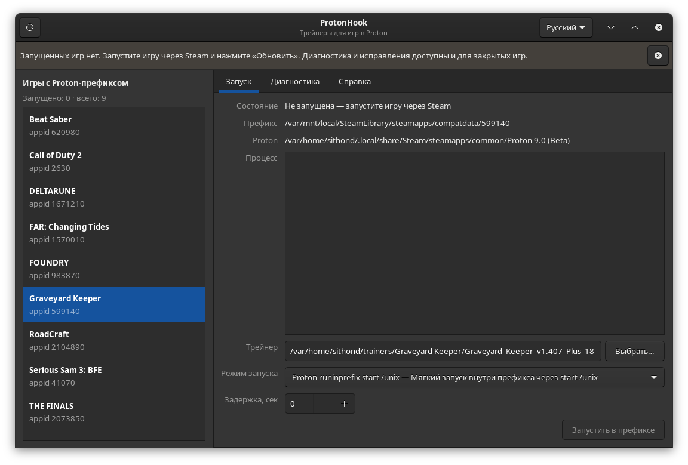
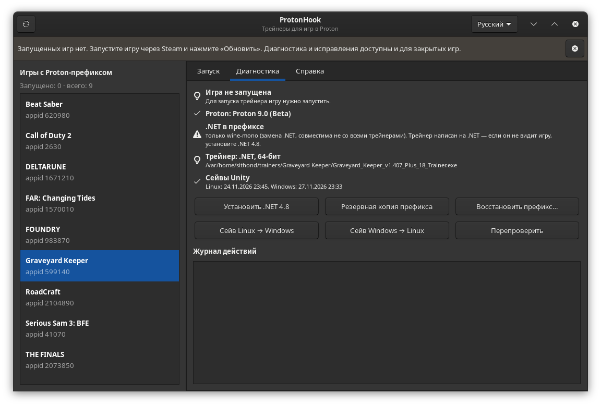
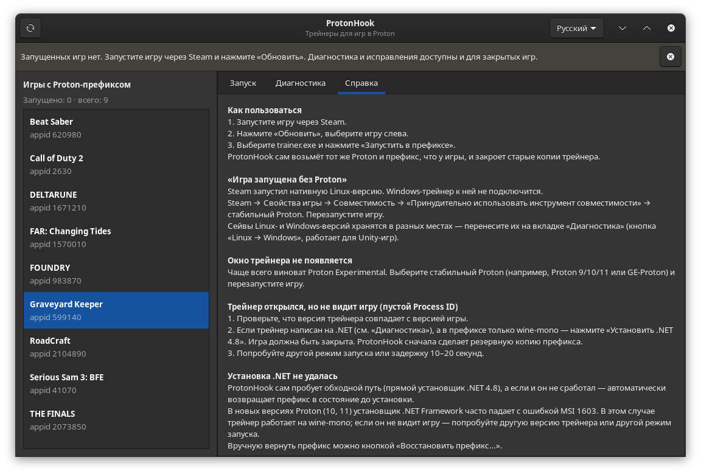

<!-- SITHOND PROJECT README -->

<div align="center">

<sub>SITHOND / PROJECTS</sub>

<br>


# ProtonHook

**Windows-трейнеры для Steam-игр в Linux. Как в Windows.**

[](https://github.com/SitHond/ProtonHook/releases)
[](LICENSE)
[](https://github.com/SitHond/ProtonHook/stargazers)


<br>

[](https://sithond.com)
[](https://discord.gg/GdQ68QhWaB)
[](https://github.com/SitHond/ProtonHook/releases/latest)

<br>

[Обзор](#обзор) ·
[Возможности](#возможности) ·
[Установка](#установка) ·
[Использование](#использование) ·
[Частые проблемы](#частые-проблемы) ·
[Сообщество](#сообщество)

[English](README.md) · [Русский](README.ru.md)

</div>

---

## Обзор

ProtonHook запускает Windows-трейнеры (`trainer.exe`) для Steam-игр, которые работают через Proton в Linux и на Steam Deck.

Он находит запущенную игру, берёт её версию Proton и префикс и запускает трейнер рядом с ней, в том же Wine-окружении. А если что-то не так — игра запущена как нативная Linux-версия, трейнеру нужен .NET, сейвы разошлись — ProtonHook это замечает и исправляет в один клик.

<div align="center">



<sub>ProtonHook — вкладка «Запуск»</sub>

</div>

## Возможности

- **Поиск игр** — запущенные через Proton и все игры с Proton-префиксом во всех библиотеках Steam, включая другие диски.
- **Правильное окружение** — трейнер получает Proton, префикс и wineserver игры; три режима запуска и задержка старта.
- **Диагностика** — замечает нативную Linux-версию, Proton Experimental, трейнеры, которым нужен .NET (включая загрузчики FLiNG), и устаревшие сейвы.
- **Исправления в один клик** — ставит .NET Framework 4.8 через protontricks с автоматическим откатом при неудаче, переносит сейвы Unity-игр между Linux- и Windows-версией, делает и восстанавливает резервные копии префикса.
- **Без рутины** — закрывает старые копии трейнера, запоминает трейнер для каждой игры, сам ищет трейнеры в `~/trainers` и `~/Downloads`.
- **Русский и английский** — язык интерфейса переключается в заголовке окна; встроенная справка по частым проблемам.
- **Плагин для Decky Loader** — запуск трейнера из Quick Access Menu на Steam Deck.

## Установка

### Требования

- Linux со Steam и Proton (ПК или Steam Deck).
- Бинарник уже содержит GTK; для версии `.pyz` нужны Python 3.10+ и PyGObject (GTK 3).
- [protontricks](https://github.com/Matoking/protontricks) — только для установки .NET.

### Загрузка

Скачайте последнюю версию со страницы [Releases](https://github.com/SitHond/ProtonHook/releases/latest) или установите из терминала:

```bash
curl -L -o ~/.local/bin/protonhook \
  https://github.com/SitHond/ProtonHook/releases/latest/download/protonhook
chmod +x ~/.local/bin/protonhook
protonhook
```

| Файл | Описание |
| :--- | :--- |
| `protonhook` | Один исполняемый файл, GTK внутри |
| `protonhook.pyz` | Лёгкая версия (~100 КБ), использует системные Python и PyGObject |
| `ProtonHook-decky.zip` | Плагин для Decky Loader |
| `SHA256SUMS` | Контрольные суммы |

### Сборка из исходников

```bash
git clone https://github.com/SitHond/ProtonHook.git
cd ProtonHook
python3 steam_trainer_launcher.py
```

Один исполняемый файл:

```bash
python3 -m venv --system-site-packages .venv
.venv/bin/pip install pyinstaller
PYINSTALLER=.venv/bin/pyinstaller packaging/build.sh 0.1.0   # → dist-release/
```

## Использование

1. Запустите игру через Steam.
2. Откройте ProtonHook — запущенная игра будет вверху списка с пометкой **●**.
3. Выберите `trainer.exe` (в следующий раз ProtonHook подставит его сам) и нажмите **«Запустить в префиксе»**.

Если трейнер не работает, откройте вкладку **«Диагностика»**: там видно, что не так, и есть кнопка для исправления.

<div align="center">




<sub>Диагностика и встроенная справка</sub>

</div>

### Файлы и логи

| Что | Где |
| :--- | :--- |
| Общий лог | `/tmp/protontrek.log` |
| Лог запуска трейнера | `/tmp/protontrek-<игра>-<appid>.log` |
| Резервные копии префиксов и сейвов | `~/ProtonHook-backups/` |
| Настройки (язык, трейнеры) | `~/.config/protonhook/settings.json` |

### Плагин для Decky Loader

Скачайте `ProtonHook-decky.zip` из [последнего релиза](https://github.com/SitHond/ProtonHook/releases/latest), включите Developer Mode в настройках Decky Loader и выберите **Install Plugin from ZIP**.

## Частые проблемы

| Симптом | Причина | Что делать |
| :--- | :--- | :--- |
| «Игра запущена без Proton» | Steam запустил нативную Linux-версию | Steam → Свойства → Совместимость → стабильный Proton; сейвы перенесите кнопкой **«Сейв Linux → Windows»** |
| Окно трейнера не появляется | Proton Experimental | Выберите стабильный Proton (9 / 10 / 11 или GE-Proton) |
| Трейнер не видит игру | Версия трейнера не совпадает с игрой или трейнеру нужен настоящий .NET | Проверьте версию; на «Диагностике» нажмите **«Установить .NET 4.8»** (игра закрыта) |
| Установка .NET не удалась | Известный сбой установщика .NET в новых Proton (MSI 1603) | ProtonHook сам откатит префикс; попробуйте другую версию трейнера |
| Steam сообщает о конфликте сохранений | Сейв перенесён, а в облаке старый | Выберите локальные файлы |

> [!WARNING]
> Используйте трейнеры только в одиночных играх. В играх с античитом (EAC, BattlEye и др.) это может привести к бану.

## Технологии


## Сообщество

<div align="center">

### SitHond Community

**All projects. One community.**

Единое сообщество всех проектов SitHond:
экспериментов, программ и игр.

Обсуждайте разработку, предлагайте идеи,
получайте помощь, делитесь отзывами и следите за релизами.

[](https://discord.gg/GdQ68QhWaB)

[Сайт](https://sithond.com) ·
[GitHub](https://github.com/SitHond) ·
[Discord](https://discord.gg/GdQ68QhWaB)

</div>

## Участие в разработке

Предложения, отчёты об ошибках и pull request'ы приветствуются.

- Сообщайте об ошибках через [GitHub Issues](https://github.com/SitHond/ProtonHook/issues).
- Обсуждайте идеи в Discord-сообществе.
- Присылайте pull request'ы. Для новых строк интерфейса нужен английский перевод в `i18n.py` — CI проверяет это тестом `tests/test_i18n.py`.

## Лицензия

Проект распространяется на условиях, описанных
в файле [LICENSE](LICENSE).

---

<div align="center">

<sub>PART OF THE SITHOND ECOSYSTEM</sub>

### sithond.

**Simple by design. Built with curiosity.**

[Сайт](https://sithond.com) ·
[GitHub](https://github.com/SitHond) ·
[Discord](https://discord.gg/GdQ68QhWaB)

<sub>Made with curiosity by SitHond.</sub>

</div>
